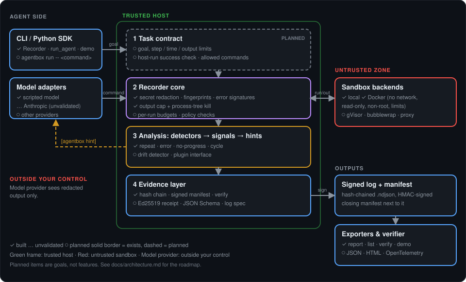

# agentbox

**A tamper-evident flight recorder for AI agents.**

Run agent commands in an isolated sandbox, record what actually happened, sign every record, and catch agents that get stuck.

> [!NOTE]
> **v0.1, early research prototype.** Interfaces will change and it is not production-ready. Known gaps are listed under [Limitations](#limitations).

---

## Why agentbox

Most agent tooling records what the agent *says* it did, from inside the agent's own process. agentbox observes from the outside.

| | What it gives you |
|---|---|
| **Host-side capture** | Output, exit codes and timing are recorded by the host, not reported by the agent. |
| **Tamper-evident logs** | Every record is hash-chained and HMAC-signed with a key that never enters the sandbox. Edits, deletions and reordering are detected by `agentbox verify`. |
| **State-aware loop detection** | A repeated command only counts when the workspace did not change, which separates retrying from making progress. |
| **Hint feedback** | When the detector fires, a hint is added to the agent's next observation so it can change approach. |
| **Hardened sandbox** | Docker backend with no network, read-only root filesystem, dropped capabilities, non-root user and resource limits. |

## Architecture

  

| Module | Role |
|---|---|
| `signer.py` | Hash-chained, HMAC-signed event log and `verify_file` |
| `executor.py` | Local command runner, error fingerprints, workspace hashing |
| `docker_backend.py` | Runs commands in a locked-down container |
| `loop_detector.py` | Exact repeat, repeated error, no-progress and cycle detection |
| `recorder.py` | Main API: `Recorder.run(command)` |
| `agent.py` | Minimal ReAct-style loop that feeds detector hints back to the model |

## Quick start

Requires Python 3.10+. Docker is optional and used by the sandbox demos.

~~~bash
git clone https://github.com/Prathmesh010190/Agentboxx.git
cd Agentboxx
python3 -m venv .venv && source .venv/bin/activate
pip install -e ".[dev]"
pytest
~~~

Run the demos:

~~~bash
python examples/demo_agent.py            # stuck-agent demo (local backend)
python examples/demo_docker.py           # shows what the Docker sandbox blocks
python examples/demo_agent_loop.py       # full pipeline: detect, hint, recover

agentbox report runs/agent-demo.ndjson   # readable summary
agentbox verify runs/agent-demo.ndjson   # integrity check
~~~

### Example: a stuck agent recovers

The scripted agent repeats a failing command. After the third identical failure on an unchanged workspace, the detector raises warnings and the next observation carries a hint:

~~~text
[2] Run it.
    $ python3 main.py  -> exit 1
[3] Run it.
    $ python3 main.py  -> exit 1
[4] Run it.
    $ python3 main.py  -> exit 1
    !! warn: loop.exact
    !! warn: loop.error_repeat
    !! warn: loop.no_progress
[5] The hint is right: x = 0 causes the crash. Fix the value.
    $ sed -i 's/x = 0/x = 2/' main.py  -> exit 0
[6] Run it again.
    $ python3 main.py  -> exit 0

Result: {'reason': 'final_answer', 'final': 'Fixed the divide-by-zero; script prints 5.0.'}
~~~

### Example: tamper detection

Change any value in a log file and verification fails:

~~~text
$ agentbox verify runs/demo.ndjson
LOG HAS BEEN TAMPERED WITH OR IS CORRUPT:
  - line 3: content was modified
~~~

## Use it in your own agent

~~~python
from agentbox import Recorder
from agentbox.docker_backend import DockerSandbox

sandbox = DockerSandbox("./workspace")   # no network by default
sandbox.start()
rec = Recorder("my-session", workspace="./workspace", sandbox=sandbox)

result = rec.run("pytest -x", thought="Run the tests")
print(result["signals"])                 # loop warnings, if any

rec.close("done")                        # also stops the container
~~~

`agentbox.agent.run_agent` wraps this in a ReAct-style loop. `ScriptedModel` needs no API key. `AnthropicModel` is an optional adapter (`pip install anthropic`, set `ANTHROPIC_API_KEY`) and has **not yet been validated against the live API** ([#5](https://github.com/Prathmesh010190/Agentboxx/issues/5)).

## What `agentbox verify` reports

| Result | Exit code | Meaning |
|---|---|---|
| `OK` | 0 | Chain, signatures and the closing manifest all match |
| `TAMPERED` | 1 | A record was edited, removed or reordered, or the log no longer matches its signed manifest |
| `INCOMPLETE` | 2 | The log is intact so far but was never closed: a crash, a running session, or a removed tail |

The manifest (`<session>.manifest.json`) is written when a session closes and records the final record count and hash, signed with the same key. Limits: if someone truncates the log and also deletes the manifest, the result is `INCOMPLETE` rather than `TAMPERED`, because that looks like a crash. Anyone who can read the signing key can forge both files, so copy manifests somewhere the agent host cannot write to if that matters. Public-key signing, as used for Nanda Town's evidence attestations, would let third parties verify logs without holding a secret, and is a possible future change.

## Detection signals

| Signal | Meaning |
|---|---|
| `loop.exact` | The same command was repeated on an unchanged workspace |
| `loop.error_repeat` | The same normalized error keeps recurring |
| `loop.no_progress` | Several steps failed while no files changed |
| `loop.cycle` | The agent alternates between the same few commands |

Warnings become hints for the model. Critical severity (for example five identical repeats) stops the run.

## Error signatures

Repeated-error detection compares normalized error signatures, so the same failure matches even when line numbers, file paths or runtime versions differ.

| Language | Recognized output | Signature class |
|---|---|---|
| Python | Tracebacks | Exception name, e.g. `ZeroDivisionError` |
| Node.js | Uncaught errors with stack frames | e.g. `TypeError`, `Error[ERR_MODULE_NOT_FOUND]` |
| Go | Panics, fatal errors, compile errors | `GoPanic`, `GoFatalError`, `GoCompileError` |

Anything else falls back to hashing the last lines of stderr. To add a language, see `src/agentbox/error_signatures.py`.

## Threat model

- **Docker backend:** commands run as a non-root user in a container with no network, a read-only root filesystem, all Linux capabilities dropped, `no-new-privileges`, and CPU, memory and process limits. The signing key and logs stay on the host and are never mounted into the container.
- **Local backend:** no isolation. The agent runs as your user and could read the signing key. Use it only for trusted experiments.
- Docker isolation is strong but not a perfect boundary. Run untrusted agents in a disposable VM.
- The log shows that records were not altered after writing. It does not prove the agent's intent, and it cannot see anything that bypasses the executor.

## Limitations

- Detector thresholds are initial values, not calibrated on real agent traces.
- No network capture yet (the sandbox simply has no network).
- No semantic drift detection yet; detection is command and state based.
- Error signatures cover Python, Node.js and Go only. Other languages use a generic fallback.

## Roadmap

- [x] Signed, hash-chained event log with verification
- [x] Docker sandbox backend
- [x] Loop detection with hint feedback
- [x] ReAct-style agent loop
- [x] Stable error signatures for Python, Node.js and Go
- [ ] Validate against a live model ([#5](https://github.com/Prathmesh010190/Agentboxx/issues/5))
- [ ] Network egress capture
- [ ] Semantic drift detector
- [ ] Session replay UI
- [ ] Threshold calibration on recorded sessions

## Contributing

Contributions are welcome. Start with [CONTRIBUTING.md](CONTRIBUTING.md) and the issues labeled [`good first issue`](https://github.com/Prathmesh010190/Agentboxx/labels/good%20first%20issue).

## License

Apache-2.0. See [LICENSE](LICENSE).
