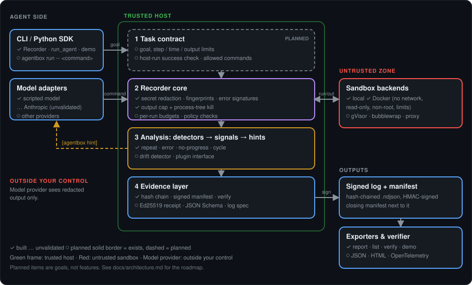

  
  
  
  
  

> [!NOTE]
> **v0.3.0.** Live on [PyPI](https://pypi.org/project/agentboxx/) (`pip install agentboxx`). Validated end-to-end with sandboxed execution, cryptographic signing, loop detection, and live model execution. Interfaces may evolve before v1.0. Known gaps are listed under [Limitations](#limitations).

---

## Why agentboxx

Most agent tooling records what the agent *says* it did, from inside the agent's own process. agentbox observes from the outside.

| | What it gives you |
|---|---|
| **Host-side capture** | Output, exit codes and timing are recorded by the host, not reported by the agent. |
| **Tamper-evident logs** | Every record is hash-chained and HMAC-signed with a key that never enters the sandbox. Edits, deletions and reordering are detected by `agentbox verify`. |
| **State-aware loop detection** | A repeated command only counts when the workspace did not change, which separates retrying from making progress. |
| **Hint feedback** | When the detector fires, a hint is added to the agent's next observation so it can change approach. |
| **Hardened sandbox** | Docker backend with no network, read-only root filesystem, dropped capabilities, non-root user and resource limits. |

## Architecture

  

| Module | Role |
|---|---|
| `signer.py` | Hash-chained event log, HMAC signatures and Ed25519 run receipts |
| `executor.py` | Local command runner, error fingerprints, workspace hashing |
| `docker_backend.py` | Runs commands in a locked-down container |
| `loop_detector.py` | Exact repeat, repeated error, no-progress and cycle detection |
| `recorder.py` | Main API: `Recorder.run(command)` |
| `agent.py` | Minimal ReAct-style loop that feeds detector hints back to the model |

## Quick start

Requires Python 3.10+. Docker is optional and used by the sandbox demos.

~~~bash
pip install agentboxx
~~~

Or install from source:

~~~bash
git clone https://github.com/Prathmesh010190/Agentboxx.git
cd Agentboxx
python3 -m venv .venv && source .venv/bin/activate
pip install -e ".[dev]"
pytest
~~~

Try it with one command (no Docker, no API key, nothing left behind):

~~~bash
agentbox demo
~~~

Run the demos from the repo:

~~~bash
python examples/demo_agent.py            # stuck-agent demo (local backend)
python examples/demo_docker.py           # shows what the Docker sandbox blocks
python examples/demo_agent_loop.py       # full pipeline: detect, hint, recover

agentbox keygen                          # generate Ed25519 keypair (~/.agentbox/ed25519.pub)
agentbox report runs/agent-demo.ndjson   # readable summary
agentbox verify runs/agent-demo.ndjson   # symmetric integrity check
agentbox verify runs/agent-demo.ndjson --pubkey ~/.agentbox/ed25519.pub  # public-key receipt check
agentbox list                            # every log in ./runs: session, start time, steps, verifies?
agentbox --version
~~~

`report` uses color for errors and warnings when writing to a terminal. Set `NO_COLOR=1` to turn it off. It supports `--format text|json|html` (default: `text`) and `--output <file>` (or `-o`) to export reports; HTML reports are completely self-contained with no external assets.

### Example: a stuck agent recovers

The scripted agent repeats a failing command. After the third identical failure on an unchanged workspace, the detector raises warnings and the next observation carries a hint:

~~~text
[2] Run it.
    $ python3 main.py  -> exit 1
[3] Run it.
    $ python3 main.py  -> exit 1
[4] Run it.
    $ python3 main.py  -> exit 1
    !! warn: loop.exact
    !! warn: loop.error_repeat
    !! warn: loop.no_progress
[5] The hint is right: x = 0 causes the crash. Fix the value.
    $ sed -i 's/x = 0/x = 2/' main.py  -> exit 0
[6] Run it again.
    $ python3 main.py  -> exit 0

Result: {'reason': 'final_answer', 'final': 'Fixed the divide-by-zero; script prints 5.0.'}
~~~

### Example: tamper detection

Change any value in a log file and verification fails:

~~~text
$ agentbox verify runs/demo.ndjson
LOG HAS BEEN TAMPERED WITH OR IS CORRUPT:
  - line 3: content was modified
~~~

## Use it in your own agent

~~~python
from agentbox import Recorder
from agentbox.docker_backend import DockerSandbox

sandbox = DockerSandbox("./workspace")   # no network by default
sandbox.start()
rec = Recorder("my-session", workspace="./workspace", sandbox=sandbox)

result = rec.run("pytest -x", thought="Run the tests")
print(result["signals"])                 # loop warnings, if any

rec.close("done")                        # also stops the container
~~~

`agentbox.agent.run_agent` wraps this in a ReAct-style loop. `ScriptedModel` needs no API key. `GeminiModel` connects to Google Gemini via standard-library REST (needs `GEMINI_API_KEY`, validated end-to-end). `AnthropicModel` is an optional adapter (`pip install anthropic`, set `ANTHROPIC_API_KEY`).

### LangChain & LangGraph integration

Agentboxx records LangChain tool executions into its cryptographic flight recorder:

~~~bash
pip install "agentboxx[langchain]"
~~~

Use `AgentboxxCallbackHandler` directly with tools, agents, or chains:

~~~python
from agentbox.integrations.langchain import AgentboxxCallbackHandler
from langchain_core.tools import tool

@tool
def calculate(expression: str) -> str:
    """Evaluate a math expression."""
    return str(eval(expression))

handler = AgentboxxCallbackHandler("session-langchain")
calculate.invoke({"expression": "10 * 4.2"}, config={"callbacks": [handler]})
handler.close("finished")
~~~

Run `agentbox verify runs/session-langchain.ndjson` to verify the log's cryptographic integrity.

### Task contracts & host-side assertions

Instead of trusting an agent's self-reported claim that a task succeeded, attach a `TaskContract` to enforce execution boundaries (maximum steps, cumulative duration, deadline) and execute objective host-side success assertions:

~~~python
from agentbox import (
    Recorder,
    TaskContract,
    assert_file_exists,
    assert_file_contains,
    assert_command,
)

contract = TaskContract(
    task_id="solve-issue-42",
    max_steps=15,
    deadline_s=120.0,
    assertions=[
        assert_file_exists("dist/bundle.js"),
        assert_file_contains("package.json", r'"version":\s*"1\.0\.0"'),
        assert_command("pytest tests/test_solution.py"),
    ],
)

rec = Recorder("eval-session", workspace="./workspace", contract=contract)
# Run agent actions...
rec.close("finished")
~~~

The evaluation verdict (`contract.verdict`) is HMAC-signed and hash-chained into the flight log, and surfaced in `agentbox report` (text, JSON, and HTML).

## What `agentbox verify` reports

| Result | Exit code | Meaning |
|---|---|---|
| `OK` | 0 | Chain, signatures and the closing manifest all match |
| `TAMPERED` | 1 | A record was edited, removed or reordered, or the log no longer matches its signed manifest |
| `INCOMPLETE` | 2 | The log is intact so far but was never closed: a crash, a running session, or a removed tail |
| *(error)* | 3 | The file is missing, empty, a directory or unreadable. This is not a verdict on the log, and `report` uses the same code |

The manifest (`<session>.manifest.json`) is written when a session closes and records the final record count and hash, signed with the same key. The verifier requires the manifest: a closed session whose manifest is missing is reported as `INCOMPLETE`, and a truncated log whose manifest is still present is reported as `TAMPERED`. Anyone holding the symmetric signing key can verify HMAC signatures. For third-party and customer verification, Agentbox generates an asymmetric Ed25519 run receipt (`<session>.receipt.json`) on close. Auditors holding only the public key can verify that the run was executed and finalized by the keyholder without holding the private signing secret.

## Detection signals

| Signal | Meaning |
|---|---|
| `loop.exact` | The same command was repeated on an unchanged workspace |
| `loop.error_repeat` | The same normalized error keeps recurring |
| `loop.no_progress` | Several steps failed while no files changed |
| `loop.cycle` | The agent alternates between the same few commands |

Warnings become hints for the model. Critical severity (for example five identical repeats) stops the run.

## Sandbox resource and crash events

With the Docker backend, the host records two extra signed events after each step: `sandbox.resource` (memory, CPU, process count) and `sandbox.crash` (an out-of-memory kill, or a container that stopped). Everything is read on the host through Docker, so the agent cannot influence it.

- Resource sampling adds about a second per step. Turn it off with `DockerSandbox(resource_stats=False)`.
- A sample is a snapshot after the step, not a peak.
- The local backend has no equivalent, and `agentbox report` does not show these events yet.

## Error signatures

Repeated-error detection compares normalized error signatures, so the same failure matches even when line numbers, file paths or runtime versions differ.

| Language | Recognized output | Signature class |
|---|---|---|
| Python | Tracebacks | Exception name, e.g. `ZeroDivisionError` |
| Node.js | Uncaught errors with stack frames | e.g. `TypeError`, `Error[ERR_MODULE_NOT_FOUND]` |
| Go | Panics, fatal errors, compile errors | `GoPanic`, `GoFatalError`, `GoCompileError` |

Anything else falls back to hashing the last lines of stderr. To add a language, see `src/agentbox/error_signatures.py`.

## Secret redaction

Commands, output and the model's reasoning are redacted **before** they are signed, because a signed record cannot be edited afterward. Recognized: private key blocks, AWS, GitHub, Slack and Google keys, `sk-` style API keys, JWTs, `Authorization` headers, passwords in URLs, and `NAME=value` where the name contains `password`, `secret`, `token` or `api_key`. Each step records only a count per pattern, never the value.

Limits to know about:
- Patterns are heuristics. They miss some secrets (for example a secret with no recognizable name or format) and sometimes hide harmless values such as a long `*_token=` setting.
- The command itself still runs with the real value. Only the **record** is redacted.
- With the agent loop, the model also receives the redacted output, so it cannot read a secret that a command printed.
- Files in the workspace are not logged, but anything a command prints from them is covered by these patterns only.
- Add your own patterns with `agentbox.redact.add_pattern(name, regex)`.

## Log format

The log format is documented in [docs/log-format.md](docs/log-format.md) and described by JSON Schemas ([record](docs/schema.json), [manifest](docs/manifest.schema.json)). [examples/verify_standalone.py](examples/verify_standalone.py) verifies a log using only the Python standard library, as an independent check that the spec is complete.

## Threat model

- **Docker backend:** commands run as a non-root user in a container with no network, a read-only root filesystem, all Linux capabilities dropped, `no-new-privileges`, and CPU, memory and process limits. The signing key and logs stay on the host and are never mounted into the container.
- **Local backend:** no isolation. The agent runs as your user and could read the signing key. Use it only for trusted experiments.
- Docker isolation is strong but not a perfect boundary. Run untrusted agents in a disposable VM.
- The log shows that records were not altered after writing. It does not prove the agent's intent, and it cannot see anything that bypasses the executor.

## Limitations

- Windows is supported and tested in CI (Python 3.11–3.13 on `windows-latest`). Process-tree termination uses `taskkill /F /T` to kill runaway commands and all their children. The Docker backend runs as user `1000:1000` in the container (override with `DockerSandbox(user=...)`); Docker Desktop with Linux containers is required. The local backend automatically discovers Git Bash (in Program Files, LocalAppData, or on PATH), using `python` instead of Unix `python3`.
- Detector thresholds are initial values, not calibrated on real agent traces.
- No network capture yet (the sandbox simply has no network).
- No semantic drift detection yet; detection is command and state based.
- Error signatures cover Python, Node.js and Go only. Other languages use a generic fallback.

## Roadmap

- [x] Signed, hash-chained event log with verification
- [x] Docker sandbox backend
- [x] Loop detection with hint feedback
- [x] ReAct-style agent loop
- [x] Stable error signatures for Python, Node.js and Go
- [x] Truncation detection with a signed closing manifest
- [x] Secret redaction before signing
- [x] Output size cap and process-tree kill on timeout ([#22](https://github.com/Prathmesh010190/Agentboxx/issues/22))
- [x] Sandbox resource and crash events (Docker backend)
- [x] Public-key signing so third parties can verify logs ([#23](https://github.com/Prathmesh010190/Agentboxx/issues/23))
- [x] Validate against a live model ([#5](https://github.com/Prathmesh010190/Agentboxx/issues/5))
- [ ] Network egress capture (design in [docs/network-egress.md](docs/network-egress.md))
- [ ] Semantic drift detector
- [ ] Session replay UI
- [ ] Threshold calibration on recorded sessions

## Contributing

Contributions are welcome. Start with [CONTRIBUTING.md](CONTRIBUTING.md) and the issues labeled [`good first issue`](https://github.com/Prathmesh010190/Agentboxx/labels/good%20first%20issue).

## License

Apache-2.0. See [LICENSE](LICENSE).
